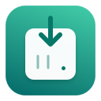

# UGREEN NAS Download

[English](../README.md) · [Français](README.fr.md) · [🌐 34](LANGUAGES.md)

Egy macOS alkalmazás és egy Safari bővítmény a letöltések elküldéséhez a NAS UGREEN **Letöltések** alkalmazásához a UGOS Pro alatt anélkül, hogy a NAS oldalt nyitva tartaná.

Források és DMG-verzió: **0.6.0**. Független közösségi projekt, nem kapcsolódik az UGREEN-hez vagy az Apple-hez.

<picture>
  <source media="(prefers-color-scheme: dark)" srcset="../Extension/icon-dark-128.png">
  
</picture>

Az alkalmazás és a bővítmény felülete 34 nyelven érhető el.

## Jellemzők

- A `.torrent` és `magnet:` linkek elfogása a Safari-ban engedélyezett webhelyeken.
- Művelet **Töltse le a NAS** eszközre a jobb gombbal kattintva egy közvetlenül elérhető hivatkozásra, képre, videóra vagy hangelemre.
- URL kézi küldése a bővítmény menüből.
- Fiók és munkamenet a kulcstartóban macOS; A kéttényezős hitelesítés és az eszközmegbízhatóság támogatása.
- A NAS opcionális keresése UGREEN online szolgáltatással vagy kézi HTTPS címmel.
- Letöltések listája, előrehaladás és sebesség; opcionális befejezési, leállítási és hibaértesítések.
- A HTTP fájlnevek és -típusok azonosítása, a letöltés utáni névjavítással, amikor a fájl egyértelműen azonosításra kerül.
- Natív világos és sötét ikonok, valamint a rendszertémához igazodó Safari logók.

## Kompatibilitás

A projekt **macOS 27 vagy újabb** verzióra van konfigurálva, és a **Xcode 27.1** programmal fordították le az Apple Silicon számára. A NAS teszteket **DXP2800**, **UGOS Pro 1.20.0.0142** és **Letöltések 1.19.1.0004** modellekkel végeztük. A többi verzió nem garantált: az integráció megfigyelt API-kon alapul, stabil UGREEN közbeszerzési szerződés nélkül.

## Telepítés a DMG-ről

[A UGREEN NAS Download 0.6.0 letöltése Mac-hez Apple Silicon](https://github.com/cshxbe/UGREEN-NAS-Download/releases/tag/v0.6.0).

1. Nyissa meg a DMG-t, húzza a **UGREEN NAS Download** elemet az **Alkalmazások** közé, majd nyissa meg az alkalmazást.
2. A **Safari → Beállítások → Speciális** menüpontban engedélyezze a funkciókat a webfejlesztők számára. A **Fejlesztőben** engedélyezze az **Aláíratlan bővítmények engedélyezése** lehetőséget, majd engedélyezze a **UGREEN NAS Download** lehetőséget a **Bővítmények** részben.
3. Konfigurálja a NAS-t a bővítmény beállításaiban.

Ez a nyilvános csomag helyben van aláírva (ad hoc), és nincs közjegyzői hitelesítve. A macOS blokkolhatja a kezdeti nyitását. A Safari kérheti az engedély újbóli engedélyezését az aláíratlan bővítményekhez, miután kilép a böngészőből.

## Forrásból fordítsd le

1. Klónozza ezt a tárolót, és nyissa meg a `Xcode/UGREEN NAS Download/UGREEN NAS Download.xcodeproj`-t.
2. Az **Aláírás és képességek** részben válassza ki saját Apple-csapatát a két célhoz: az alkalmazáshoz és annak bővítményéhez. Személyes csapat nem kerül be az adattárba.
3. Válassza ki a **UGREEN NAS Download** sémát, a célhelyet a **My Mac**, majd fordítsa le és indítsa el a Xcode segítségével.
4. Aktiválja a bővítményt a **Safari → Beállítások → Bővítmények** menüpontban, majd engedélyezze a kívánt webhelyeket.
5. Nyissa meg a bővítmény beállításait, és konfigurálja a NAS készüléket az alábbiak szerint.

A példacsomag-azonosítók a `com.example.UGREENNASDownload` és a `com.example.UGREENNASDownload.Extension`. Ha testre kell szabnia őket az aláírásához, módosítsa a Xcode projektazonosítókat **és** a megfelelő konstansokat a `Extension/background.js` és `ViewController.swift`-ban: az értékeknek konzisztensnek kell maradniuk.

Ez a nyilvános kiadás a személyes fejlesztési alkalmazástól elkülönített azonosítókat és kulcstartó teret használ. Ehhez a NAS saját konfigurációja szükséges. A fejlesztési aláírás nem minősül közjegyző által hitelesített terjesztésnek, és az aktiváláshoz szükség lehet az aláírásának megfelelő Safari fejlesztési beállításokra.

Aláírás nélküli összeállítás ellenőrzéséhez a tároló gyökéréből:

```sh
xcodebuild \
  -project "Xcode/UGREEN NAS Download/UGREEN NAS Download.xcodeproj" \
  -scheme "UGREEN NAS Download" \
  -configuration Release -destination 'platform=macOS,arch=arm64' \
  -derivedDataPath ./build CODE_SIGNING_ALLOWED=NO build
```

Ez az ellenőrzés aláíratlan alkalmazást eredményez; használja az Apple csapatát egy használható fejlesztői telepítéshez a Safari-ban. Tartsa meg a lerakatfát: a Xcode–`Extension` és `Design` hivatkozások relatívak.

## Konfigurálja a NAS-t

1. Adja meg a NAS HTTPS címét a portjával, az azonosítójával és az abszolút cél elérési útjával a NAS-n. A személyes mezők alapértelmezés szerint üresek.
2. Kattintson a **NAS tanúsítvány ellenőrzése** lehetőségre. A tanúsítvány megerősítése előtt hasonlítsa össze a SHA-256 ujjlenyomatot egy megbízható forrással.
3. Adja meg a jelszót, és ha szükséges, egy kettős hitelesítési kódot. Az eszközben való megbízás nem kötelező; enélkül a munkamenet lejártakor új kódra lehet szükség.
4. Kattintson a **Mentés és kapcsolat tesztelése** gombra. A macOS kérésére engedélyezze a helyi hálózathoz való hozzáférést.
5. Ha szükséges, engedélyezze a torrentek és mágnesek automatikus elfogását. A jobb gombbal történő kattintás és a kézi küldés független ettől a kapcsolótól.

A cím, fiók és mappa továbbra is módosítható a beállításokban. **A fiók elfelejtése** törli a fiókot és a kulcstartó munkamenetet az aktuális Safari profilhoz.

## Biztonság és működés

A weboldalak nem konfigurálhatják a fiókot, és nem bízhatnak meg egy tanúsítványban. A bővítmény natív üzenetküldéssel kommunikál a Swift moduljával. A NAS kérések egy elszigetelt WebKit-motoron keresztül mennek keresztül, amelynél az átmeneti tárhely és az oldalszkriptek le vannak tiltva; a tanúsítványnak meg kell egyeznie a jóváhagyott ujjlenyomattal. A NAS átirányítások elutasítva. A jelszót a RSA kulccsal titkosítják, amelyet a NAS biztosít a HTTPS számára.

A jelszó, a token és a bejelentkezési adatok a kulcstartóban vannak tárolva, nem a webtárhelyen vagy ebben a tárolóban. Használat után az ideiglenes kód törlődik. A Safari webhelyekről származó cookie-k és azonosítók soha nem kerülnek továbbításra a NAS számára. Egyes, ugyanarról a webhelyről származó torrentek esetében a kis fájl a Safari munkamenettel kerül lekérésre a memóriából, majd helyi mentés vagy SMB nélkül továbbítja a NAS-ra; mérete 512 KiB-ra korlátozódik.

Az automatikus keresés önként lekérdezi a `api.ugnas.com`: ez a szolgáltatás látja a kapcsolat nyilvános IP-címét, de nem kap jelszót vagy NAS tokent. A kézi bevitel nem ettől a szolgáltatástól függ.

Kétértelmű válasz vagy határidő lejárta után nem kísérelnek meg új kiegészítést. Újracsatlakozás és új kísérlet csak a hitelesítés kifejezett megtagadása után engedélyezett. **A NAS által elfogadott feladat nem bizonyítja, hogy a letöltés befejeződött.**

## Korlátok

- A Safari nem helyettesíti általánosan az összes letöltést. Az automatikus lehallgatás a felismert torrent hivatkozásokat és mechanizmusokat fedi le; a jobb gombbal kattintva és a kézi bevitellel fejezheti be ezt a műveletet.
- A HTTP kapcsolatnak közvetlenül elérhetőnek kell lennie a NAS segítségével. A webhelymunkamenet által védett tartalmak, a lejárt URL, a védett videók és a `blob:` vagy `data:` fájlokban generált szokásos fájlok nem konvertálódnak nyilvános hivatkozásokká.
- A menükövetés körülbelül 3,5 másodpercet vár minden válasz után; az értesítéseket és a névjavításokat körülbelül 30 másodpercenként ellenőrzik. A Safari zárt, felfüggesztett vagy alvó Mac késleltetheti ezeket a műveleteket.
- Az ismeretlen formátumok nem kapnak kitalált kiterjesztést. Az átnevezés a letöltés befejezése után történik; a tényleges fájl rögzítve van, míg a Letöltési előzmények megtarthatják eredeti nevét.
- A korrekciók továbbra is az új, egyértelműen azonosított HTTP feladatokra korlátozódnak, kényszer csere nélkül, legfeljebb 100 függőben lévő művelettel és hét napos megőrzési idővel. A listák kategóriánként legfeljebb 10 000 feladatot tartalmazhatnak.
- A globális macOS ikonbeállítás továbbra is prioritást élvez: **Sötét → Automatikus** lehetővé teszi a téma követését. A statikus ikon a Safari bővítménylistában tiszta változatban marad; a menü- és opciólogók követik a témát.

## Fejlesztés és tesztelés

```sh
node --test Tests/autonomous.test.cjs
bash Tests/run-native-tests.sh
```

A JavaScript teszteléséhez Node.js szükséges; A natív teszteléshez macOS, Xcode eszközök, Python 3 és OpenSSL szükséges. Elindítanak egy ideiglenes helyi HTTPS kiszolgálót az 18443-as porton, és nem használnak valódi NAS fiókot. A 0.5.1-es ellenőrzés 45 JavaScript-tesztet és 121 natív vezérlőt tartalmazott. Lásd a [jelentést](../AUDIT-0.5.1.md).

- `Extension/`: menü, beállítások, Safari szkriptek és ikonok.
- `Xcode/`: AppKit alkalmazás, Swift modul, hitelesítés és szállítás NAS.
- `Design/Adaptive/UGREENIcon.icon/`: Natív ikon világos és sötét megjelenéssel.
- `Design/generate-icons.swift`: PNG-k generálása és az ablak adaptív logója.
- `Tests/`: biztonsági tesztelés, adatellenőrzés és viselkedés.

## Hivatkozások

- [ugnas-api](https://github.com/Fracizz/ugnas-api) közösségi kliens: protokoll hivatkozás, harmadik féltől származó kód nélkül, amelyet egy NAS oldalról töltöttek be.
- [Közösségi integráció UGREEN](https://github.com/Tom-Bom-badil/home-assistant_ugreen-nas/blob/main/custom_components/ugreen/api.py): hivatkozás a kettős hitelesítéshez.
- [Apple dokumentáció Safari webbővítmények](https://developer.apple.com/documentation/safariservices/packaging-a-web-extension-for-safari).

Probléma bejelentéséhez ne csatoljon jelszót, ideiglenes kódot, tokent, aláírt URL-t, privát torrentet vagy kulcstartó exportálást. Használjon fiktív adatokat a példákban.
